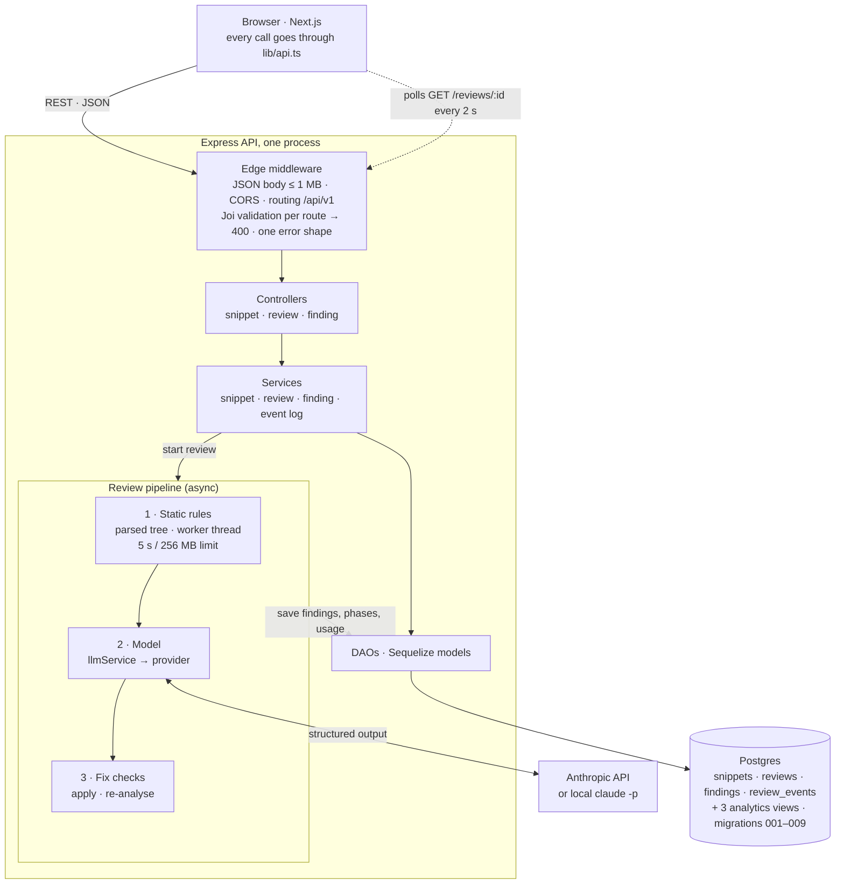

# Snippet Reviewer

Paste a code snippet and get a review in two parts. First, deterministic rules run on the parsed code, so their findings have exact lines and cost nothing. Then an AI model reviews what the rules can't see. Every finding is linked to its lines, can be marked valid or not an issue, and comes with a proposed fix that has been checked.

## Run it

**With an API key (one command):**

```bash
cp .env.example .env    # in .env: switch to Mode B and paste your ANTHROPIC_API_KEY
docker compose up --build
```

- Web: http://localhost:3000
- API: http://localhost:4000/api/v1/health
- Postgres: localhost:5433 (user, password and database are all `snippets`)

The API runs its migrations when it starts, so a fresh database gets its tables automatically. Each review's cost is its token counts times the model's list price, from a small dated table in `api/src/service/llm/prices.ts` (the API reports tokens, never dollars). To use other prices, set all four `LLM_PRICE_*_PER_MTOK` values. A model that is neither listed nor configured shows its token counts and "cost not configured". It never guesses a price.

**With a Claude Code login instead of a key** (how I developed it): Mode A in `.env.example`, already selected, runs the local `claude -p` CLI on your own login, so the API has to run on your machine rather than in Docker.

```bash
cp .env.example .env
docker compose up -d db
npm --prefix api install && npm --prefix api run dev
npm --prefix web install && npm --prefix web run dev
```

**Tests** (need the compose database running; they build their own `snippets_test` database from the migrations, and never call a model):

```bash
npm --prefix api test
```

## Architecture



**There is no separate gateway.** The Express middleware does that job inside the one process:
- a 1 MB body limit and CORS
- Joi validation on each route, so a bad request gets a 400 and the controller never runs
- routing under `/api/v1`
- one response shape, `{ message, data, success }`, for every error

In production, a gateway or load balancer would sit in front for TLS, auth and rate limits, and the review pipeline would move to workers on a job queue (see "If this were a production system").

**One review, end to end**

1. `POST /snippets/:id/reviews` saves a review as `pending` and answers **202** at once. A partial unique index allows only one pending or running review per snippet, so a second click gets **409**.
2. **Static.** The snippet is parsed and its context detected (frontend, backend, script, test or query), from imports, calls and syntax, with the reasons kept as plain words. The rules for every detected context run, plus any context the user picked. A user's choice can add rules, never remove them. Analysis runs in a worker thread with a 5-second and 256 MB limit. If it hits either, the review carries on with the model alone and says why. The rule findings are saved straight away, so the page shows them before the model answers.
3. **Model.** The model gets the line-numbered code and its context, with what to focus on for that kind of code. It also gets a short outline and the rule findings marked "already reported", so it spends its output on what the rules can't see. Its answer is checked again on our side before anything is kept:
   - the fields must match the schema
   - lines must exist in the snippet
   - at most 100 findings; descriptions up to 2,000 characters, fixes up to 4,000
   - a finding on the same line and category as a rule finding is dropped as a repeat

   It also returns a 2-3 sentence summary.

4. **Checking.** Each proposed fix (up to 50 per review) is applied and re-analysed with every rule on. It must still parse, its own rule must stop firing, and it must add no new rule hits. A model fix must also stay on its finding's lines: no more than the finding plus 10 lines replaced or written.
5. **Done.** Findings, fix checks, token usage and cost are saved together. Every step only moves the review forward from the state it expects, so a review that something else already moved on can't overwrite it.
6. **The page** polls `GET /reviews/:id` every 2 seconds while the review runs. The code and the findings sit side by side: selecting a finding highlights its exact lines, and clicking a line's dot selects its finding.

**API** (all under `/api/v1`; every response is `{ message, data, success }`)

| Method | Path                                         |                                                                          |
| ------ | -------------------------------------------- | ------------------------------------------------------------------------ |
| POST   | `/snippets`                                  | create (201); optional `context`; 400 with per-field messages            |
| GET    | `/snippets?language=&status=&limit=&cursor=` | dashboard list, newest first, cursor paging, `findingCounts` per snippet |
| GET    | `/snippets/:id`                              | snippet with its latest review and findings                              |
| POST   | `/snippets/:id/reviews`                      | start a review (202); 409 if one is already running                      |
| GET    | `/reviews/:id`                               | phase, timings, usage and cost, summary, findings with their fix checks  |
| GET    | `/reviews/:id/events`                        | what each step did, in order                                             |
| PATCH  | `/findings/:id`                              | `{ status: accepted \| dismissed \| open }`                              |
| GET    | `/languages`                                 | languages the API accepts                                                |

## Key decisions and trade-offs

- **Rules first, then the model.** Deterministic rules are exact, free and give the same answer every time. Telling the model what they already found lets it spend its output (the slow, costly part) on logic and intent instead. I haven't measured the cost saving yet. Every review logs its tokens, so the saving can be measured by comparing reviews with and without the rule hints.
- **Context decides the rules.** The same code means different risks in a React component, an Express route or a SQL query. Detection is deterministic and shows why it decided. A user can correct it, but a correction can only add rules.
- **Three languages get rules; the rest stay honest.** TypeScript/JavaScript, Python and SQL have analyzers. Every other language is reviewed by the model alone, plus the secret rule, and the page says exactly that.
- **A fix check says what it checked, and no more.** "Parses, rule cleared, no new issues" is something a machine can prove. Whether a model's fix actually solves the problem is not. So a passing model fix is labelled "Partly checked", and only a rule fix whose rule cleared shows "Fix checked ✓".
- **The verdict is computed, the summary is AI.** "Changes needed", "Looks good, with suggestions" or "Looks good" comes from the open findings, so it can't contradict the list and it updates as findings are marked. The model only writes the short summary, and it's labelled as AI.
- **The database enforces the rules that matter.** It allows one active review per snippet (that's how a double click becomes a 409), CHECK constraints refuse unknown statuses, and every step is a conditional update. The schema only changes through migrations.
- **Keep the raw facts.** Each review writes an append-only event log: rule hits, what the model was sent, kept, rejected (with the reason) and repeated, each fix check, and every accept or dismiss. Each review is also stamped with prompt and rule-set versions, so a change in results can be traced to the change that caused it. Three views answer the first questions: `v_rule_feedback` (dismiss rate per rule), `v_review_costs` and `v_model_rejections`.
- **Nothing a snippet does can take the API down.** Analysis runs in worker threads with time and memory limits. SQL nested too deeply is refused before the parser sees it. Model output, fix checks and the event log all have size limits.
- **One place talks to a model.** `llmService` picks a provider from `LLM_PROVIDER`. The headless provider runs `claude -p` isolated, with no tools, MCP servers, plugins or user settings, because the snippet is untrusted text. The API provider asks for the findings schema through the API's structured-output setting (`output_config.format`); the limits it can't express are checked on our side.
- **Polling, not push.** One review at a time, polled every 2 seconds, is plenty; Server-Sent Events would be the next step.

## What I'd do differently

**With more time**

- **Better rules.** The adversarial reviews left a list of rule gaps:
  - Python SQL built with `%` or `.format` is missed, and so is `os.system`.
  - A backslash at the end of a SQL string can hide the next statement.
  - Valid Postgres the parser doesn't know (`VACUUM`, `MERGE`) is reported as a syntax error.
  - Secrets with type annotations or inside connection URLs are missed.
  - The `== None` fix is wrong inside SQLAlchemy filters.
- **"Parses" is a syntax check only.** Code with bad indentation or a repeated `let` still passes it. Real compilers or interpreters, in a sandbox, would close that gap.
- **Measure the rule hints' effect on cost.** Run a saved set of snippets with and without the hints, and compare output tokens from the event log.
- **Server-Sent Events** for review progress, instead of polling.
- **Keep the user's decisions across re-reviews.** Fingerprint findings so a finding dismissed once isn't raised again.
- **Let users discuss a finding,** with the model able to reply.
- **An end-to-end browser test** for create → review → mark.

**If this were a production system**

- **Reviews in a real job queue with leases,** or a Postgres table read with `FOR UPDATE SKIP LOCKED`. Reviews run inside the API process today, so with several API servers, one server's restart marks the others' live reviews as failed, and a review whose server died stays "running" for the rest.
- **A cap on concurrent model calls,** and child CLI processes that are always killed with their review.
- **Cost and abuse limits:** per-user rate limits, a token budget per review, and caching reviews by a hash of the code.
- **A saved set of snippets with known issues,** run before every prompt, rule or model change, with the accept/dismiss rate tracked by rule and by source.
- **Authentication,** and snippets owned by users.

## AI usage log

**Tools**

- **Claude Code** wrote most of the code. I directed it: the stack and architecture, what to build next, and what was wrong.
- **Concord Engine**, my own open-source tool, kept parallel Claude workers consistent. Each piece of work had a contract with binding decisions, files each worker owned, and acceptance checks as commands.
- **Claude in Chrome** for using the app as a real user would.
- **Gitar** reviewed both pull requests.
- In the app itself, development uses the Claude Code CLI (`claude -p`) as the model provider. One setting switches it to the Anthropic API.

**What I decided; AI built it**

- **Static analysis before the model.** Rules run first on the parsed tree: exact, free, the same every time. The model gets their findings as "already reported" and covers only what rules can't see. The cost saving is the intent, not yet measured; the event log records tokens per review, so it can be.
- **Context detection.** Frontend, backend, script, test or query, detected from imports and calls and shown with its reasons. It picks the rules and the model's focus. A user's correction can only add rules.
- **Fix checks that say exactly what they checked.** An AI fix is only "Partly checked".
- **Every review shows its work:** steps, timings, true token counts and cost, plus a verdict computed from the open findings and a short summary labelled as AI.
- **An event log,** so quality and cost can be analysed later instead of guessed.
- **Layout:** code and findings side by side, most severe first.
- **How the work was run:** a contract before each piece of work, small commits, pull requests reviewed by Gitar, and promotion to `main` only after I'd checked the UI myself.

**Examples**

1. **It skipped migrations and tests until I asked.** Tables came from `sync()` and nothing was tested. I required migrations and tests against a real Postgres. The first test run then caught a bug AI had written: malformed JSON returned 500 instead of 400.
2. **The UI needed my eye, twice.**
   - Findings sat under the last line of their range, so a lines 5–11 finding read as a line-11 finding. AI's first proposed fix kept them in the code, and I rejected it for side-by-side.
   - Then my own screenshot showed the next problems: too narrow, every line dotted, everything tinted.
3. **I questioned numbers that looked wrong.**
   - "2 in" hid 1,948 tokens written to cache.
   - Rejected suggestions were being thrown away, which would have made any later analysis impossible.
   - "Cost not configured" on every API review: the API sends tokens, never dollars, so cost is now tokens × the model's list price, from a dated table.
4. **I had AI attack its own work.** Two adversarial reviews found 82 reproduced problems:
   - The dev provider loaded 380 tools and 357,891 tokens into each review. Isolated, that's 1 tool and 1,467 tokens.
   - A 35-character SQL snippet froze the API.
   - A badge claimed more than had been checked.

   Gitar then caught one more gap in a fix AI had just written.

5. **I didn't trust "done", or tests against a fake.**
   - Before every merge I re-ran the acceptance checks myself. More than once a worker's "done" was missing something.
   - The API-key mode had only ever been tested against a stubbed API, so I ran it for real. The first call failed: the current model refuses the forced tool call AI had used to get structured output. It now uses the API's structured-output setting.

**Overall impression**
AI made me much faster at building. Static analysis for three languages, fix checking, an event log and a redesign would not have fit in a day by hand. But it was confidently wrong in ways I had to catch: skipped migrations and tests, a layout that sounded right and read badly, a token count that was technically true and misleading, and "done" reports that weren't. What worked was treating it like a fast team that needs a lead: I made the decisions, wrote them down so every worker followed them, asked for evidence instead of claims, and checked the result myself as a user. Where it slowed me down was judgement, especially on UI and on what "done" means. Those were mine to supply.
